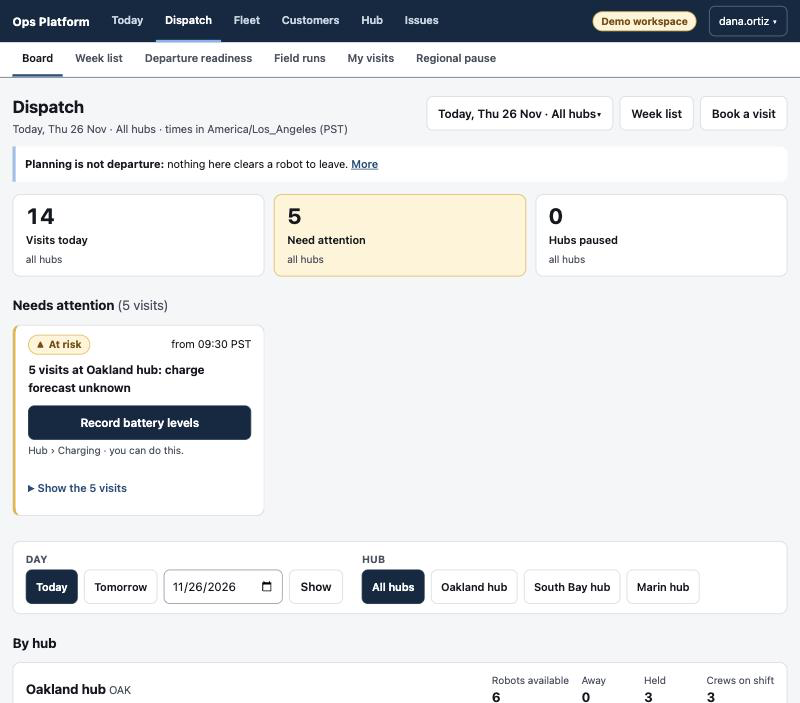
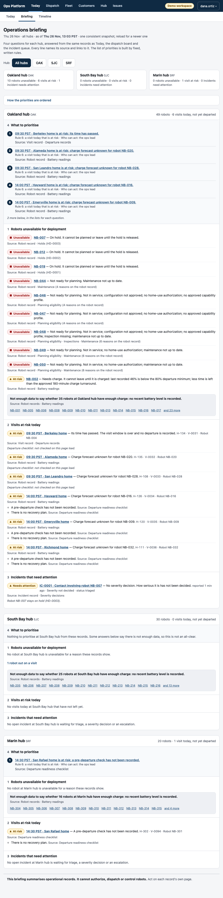
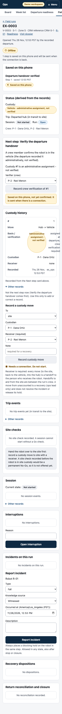
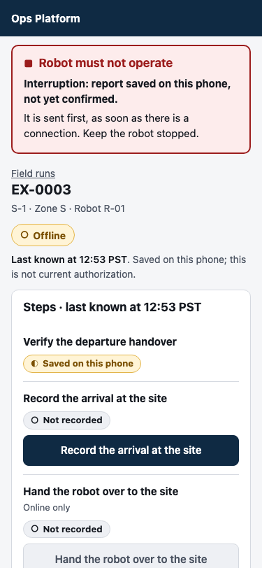
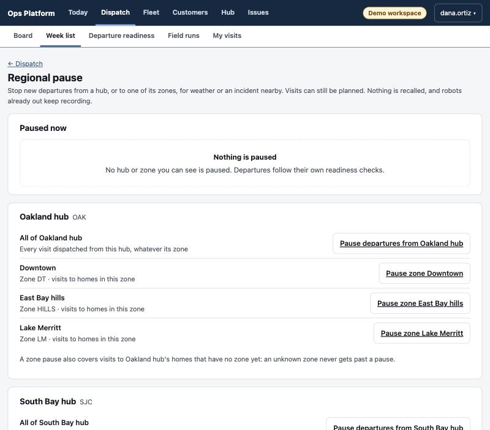
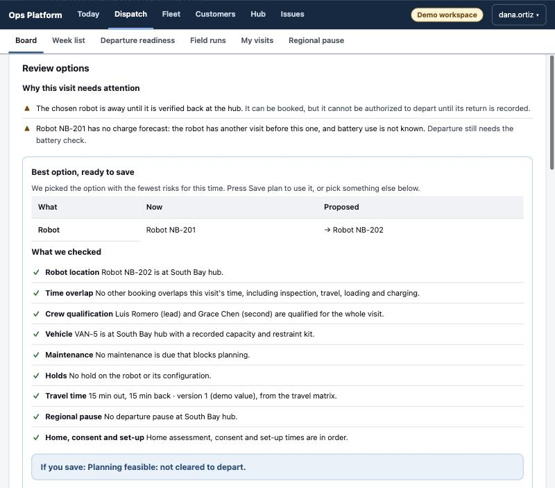

# Humanoid Robotics Operations Platform

An operations platform for a company that sends home humanoid robots out to customers' homes. It helps the people
who run the fleet decide what can go out today, record what actually happened, and keep a trustworthy history.

It **records and coordinates operations. It does not control robots**, implement emergency stops, or certify
physical safety. Every company, person, robot, home and value in this repository and in the demo is **fictional**.

**Status:** v2 release candidate (Phases 00 to 05). It has been checked by its development team only. It has **not**
been used with real robots, real homes or real crews, and **usability with independent people is UNVERIFIED**. See
[Project status and limitations](#project-status-and-limitations).

## What problem it solves

A home-robot company has robots at one or more hubs, crews with vans, and customers who book visits. Before a robot
leaves, many things must be true at the same time: the robot is not on hold, its inspections and maintenance are
current, it is charged, the crew is qualified, the household has consented, the van has the right kit, and nothing
in the region has been paused. After it leaves, someone must know where it is, who has it, and what went wrong.

Spreadsheets and chat threads lose track of this. The platform keeps one record of it, checks every rule in the
database (not only on the screen), and never shows a robot as "cleared" from data it has not checked.

## Who uses it

| Person | Main screens | What they do |
|---|---|---|
| **Ops lead** (primary user) | Today, Briefing, Dispatch board, Departure readiness, Issues | Sees what needs attention, plans visits, approves departures, triages problems, closes trips |
| **Hub technician** | Hub work queue, Charging, Stock, Transfers | Charges robots, counts kits, works hub tasks, moves robots between hubs |
| **Field crew** (lead and second) | My visits, the field run page on a phone | Records the departure, arrival, site check, session and return, also with no signal |
| **Safety reviewer, engineering lead** | Policies, rules, holds, incidents | Approve policies and rules (two people, never the author), set severity, release holds |
| **Admin** | Settings | Sets up the workspace, hubs and people; grants roles; approves nothing operational |

## Main capabilities

- **Multi-hub fleet and readiness.** Robots, vans, people, chargers, stock and visits each belong to a hub. A robot's
  location comes from its custody history. Holds, inspections and maintenance block planning and departure, in the
  database. Each visit has a readiness checklist with explained blockers. Unknown values block; they are never
  guessed.
- **Planning and the dispatch board.** Book a visit, get a suggested robot, crew and van, and see the next free time.
  The board groups today's problems by cause and hub and offers a two-click fix. Zones and an approved travel-time
  matrix drive travel times; a missing travel time blocks the visit.
- **Departure authorization and custody.** "Approved to leave" is a separate, time-limited decision by the ops lead.
  It records the exact versions it was based on, and any later change (a hold, a new inspection, a reschedule)
  invalidates it. Departure is its own record. From then on, one append-only custody chain says where the robot is
  and who has it.
- **Field execution with the offline phone screen.** The crew's run page works on a phone with no signal. Steps
  that only record facts, and protective steps (pause, stop, report a problem), are saved on the phone and sent
  later. Steps that unlock work (depart, start, resume, hand over, recover) need a live connection. Nothing shows as
  done until the server confirms it.
- **Incidents, interruptions and regional pause.** Every incident places a blocking hold on the robot in the same
  transaction. An unresolved interruption blocks the robot's next departure. The regional ops lead can pause new
  departures for a hub or a zone; the database refuses authorization and departure while the pause is active.
- **Charging.** Chargers are bookable hub resources. Battery levels are typed in by people (there is no
  telemetry). Visits whose robot will not have enough charge are marked At risk.
- **Hub transfers.** Robots, vans and stock move between hubs through an audited transfer that the receiving hub
  must accept. A transfer never clears a hold, and it invalidates any earlier departure approval.
- **Operations briefing.** A read-only page that answers four questions per hub (which robots are unavailable and
  why, which visits are at risk, which incidents need attention, what to do first) from fixed rules, with a link
  to the source of every line. It is not an AI and it cannot act.
- **Audit.** Every state change goes through one command path that writes an append-only audit row in the same
  transaction. Each visit has a dossier that rebuilds its full history.

## Screenshots

All screenshots are from the fictional demo workspace, taken in a real browser by the development team.

| | |
|---|---|
| **Dispatch board** (ops lead, desktop) <br>  | **Operations briefing** (ops lead, desktop) <br>  |
| **Field run page offline** (crew, 375 px): a step saved on the phone, and "Needs a connection. Do not start." on an online-only step <br>  | **Protective report saved offline** (crew, 375 px): "Robot must not operate" stays until the server confirms <br>  |
| **Regional pause** (ops lead) <br>  | **Plan review before saving** (ops lead) <br>  |

More screenshots: `docs/evidence/03b_design_review/`, `docs/evidence/03d_design_review/` (21 states of the phone
screen at three widths) and `docs/evidence/04_briefing/`.

## Demo

- **Public demo:** https://web-phase02rc.up.railway.app. This is the **Phase 02 release** (one hub). The demo link
  will be updated at release, after the v2 release approval.
- The demo is "Northbay Home Robotics", a fictional company. It is rebuilt every day at 12:00 UTC; during the
  rebuild (under a minute) the site shows "The demo is being refreshed" and signs everyone out. Changes made by
  visitors are not kept.
- **Demo accounts:** there is one login per role (ops lead, hub technician, crew members, safety reviewer, and so
  on). Credentials are shared separately by the project owner; they are not in this repository.
- A guided 5 to 7 minute tour: [docs/demo_walkthrough.md](docs/demo_walkthrough.md).

## Run it locally

Prerequisites: Docker, [uv](https://docs.astral.sh/uv/), make. Settings come from environment variables; the
development values are in `.env.example` (copy it to `.env` to override). Never reuse them anywhere shared.

```bash
make db        # PostgreSQL 16 in Docker on localhost:5440, with the ops_owner and ops_app roles
make migrate   # apply migrations as the schema owner (ops_owner)
```

Then load data, choosing **one** of these two (the demo builder only runs on an empty database):

```bash
# A) The demo workspace: three fictional hubs, about 100 robots, visits around today's date
set -a; source .env.example; set +a
cd backend && DJANGO_DB_IDENTITY=owner uv run python manage.py build_demo_workspace && cd ..

# B) The small development seed (dev_admin, dev_ops_lead, ... plus a few robots and visits)
make seed
```

The demo builder prints the login names. Every login uses the `DEV_SEED_PASSWORD` value from your environment.

```bash
make run       # the app on http://127.0.0.1:8000, connected as the restricted runtime role (ops_app)
```

`docker compose up --build` runs the database, migrations, the development seed and the app in containers instead.
`curl localhost:8000/healthz` reports the database and migration state.

## Tests

Tests run against a real PostgreSQL (the `make db` container), including tests that connect as the restricted
runtime role and try to bypass the rules with direct SQL.

```bash
uv --directory backend run playwright install chromium   # once: the real-browser tests need Chromium
make test      # the full suite
make ci        # what CI runs: lint, format check, type check, migration check, tests
```

To run part of the suite, from `backend/` with the environment loaded (`set -a; source ../.env.example; set +a`):

```bash
DJANGO_DB_IDENTITY=owner uv run pytest tests/test_v2_03c_sync.py   # one file
DJANGO_DB_IDENTITY=owner uv run pytest -m "not browser"            # skip the Chromium tests
DJANGO_DB_IDENTITY=owner uv run pytest -m perf -s tests/test_v2_05_scale.py   # 500-robot p95 benchmark (slow)
```

Markers: `browser` (Playwright and Chromium), `perf` (time budgets, skipped unless you pass `-m perf`), `xlsx`
(capacity workbook check, needs LibreOffice). GitHub Actions runs `.github/workflows/ci.yml` on every push and
`.github/workflows/perf.yml` on demand.

## Repository layout

| Path | What |
|---|---|
| `backend/config` | Django settings (all from environment variables) and URLs |
| `backend/platform_core` | `run_command` (the one path for state changes), audit events, idempotency keys, hubs, zones, workspace setup, shared UI components |
| `backend/accounts` | Roles, hub-scoped role grants, permission checks, login |
| `backend/fleet` | Robots, configurations, holds, inspections, maintenance rules, robot location, hub transfers |
| `backend/planning` | Homes, consent, crews and vans, visits, reservations, Suggest, next free time, travel matrix, dispatch board |
| `backend/readiness` | Readiness policies, evidence, the checklist, departure authorization and departure |
| `backend/execution` | Field runs, custody, site checks, sessions, interruptions, incidents, the offline field protocol and phone screen |
| `backend/hub` | Hub work queue, charging, stock, transfer pages |
| `backend/operations` | Today, Briefing, Issues, timeline, metrics, fleet health, close-out, regional pause, the demo workspace builder |
| `backend/capacity` | Capacity forecast report |
| `backend/deploy` | Start script, database bootstrap, demo refresh, backup and restore check |
| `backend/tests` | Test suite (real PostgreSQL; `tests/browser` uses Chromium) |
| `docs/` | Contracts, closure notes and evidence, runbook |

## Further reading

- [Architecture](docs/architecture.md): layers, database enforcement, the command boundary, hubs, lock order, the
  offline protocol, performance, deployment.
- [Demo walkthrough](docs/demo_walkthrough.md): a guided scenario, role by role.
- [Release notes v2 (DRAFT)](docs/release_notes_v2.md): what each phase added, verified scale, known limitations.
- [Runbook](docs/runbook_deploy_backup_rollback.md): deploy, health check, backup, restore, rollback, demo refresh.
- Contracts: `docs/09_v2_phase00_contract.md` to `docs/13_v2_phase03_contract.md`. Evidence: `docs/evidence/`.

## Project status and limitations

- **Fictional data only.** No value is a real robot specification, maintenance interval, travel time, price or
  safety approval. Demo approvals are on `synthetic_demo` records, and production mode refuses every one of them.
- **No real-world validation.** Nothing has been used with real robots, homes or crews.
- **Usability is UNVERIFIED.** All walkthroughs were done by the development team, not by independent users.
- **Scale:** a synthetic benchmark of 500 robots, 5 hubs and 5,000 visits met its time budgets in CI. A 500-robot
  synthetic benchmark does not establish production capacity for 500 physical robots.
- **No telemetry.** Battery levels and robot state are entered by people.
- **Offline is for the field run page only**, and only for steps that record facts or make things safer. Photos and
  signatures are not supported.
- **No live customer messaging, no automatic safety approvals, no AI.** The briefing is fixed rules.
- **Not production-ready:** production needs real approved procedures, inspection templates, maintenance rules and
  hold-release policies that do not exist yet (Settings > Production readiness lists them).

The full list is in [docs/release_notes_v2.md](docs/release_notes_v2.md#known-limitations).
