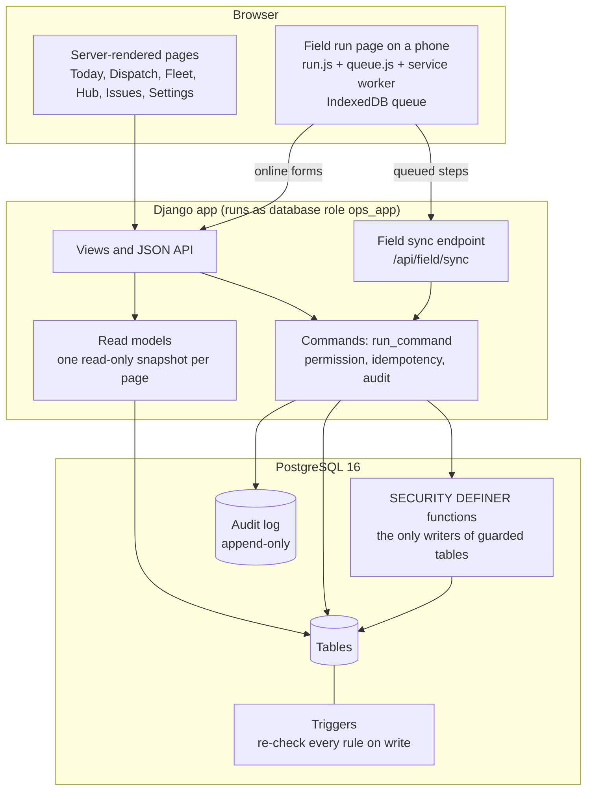

# Architecture

This document explains how the Humanoid Robotics Operations Platform is built and why. It is written for an
engineer who has never seen the repository. It describes the code at the v2 release candidate (branch
`v2/phase03`). All data is fictional.

The binding details live in the contracts (`docs/09_v2_phase00_contract.md` to `docs/13_v2_phase03_contract.md`)
and the closure notes in `docs/evidence/`. Where this document and a contract differ, the contract wins.

## 1. The big picture

The platform is one Django 5.1 application with one PostgreSQL 16 database per workspace (a customer company, or
the demo). Pages are rendered on the server. There is no separate front-end application. The only JavaScript of
note is the offline field screen, which is added on top of the server-rendered run page.



Three ideas shape everything below:

1. **The database is the last line of defence.** Every safety rule (holds, eligibility, custody, readiness,
   authorization, pauses, hub authority) is enforced by PostgreSQL itself, so a bug in a view or a direct SQL
   statement from the application role cannot get around it.
2. **One path for every change.** Every state change goes through `run_command`, which checks permission, writes
   the audit row and applies idempotency in one transaction.
3. **Never decide from data you have not checked.** Unknown values block. A phone's cached data never decides
   anything. Pages show "Not enough data" instead of a guess.

## 2. Application layers

| Layer | Where | What it does |
|---|---|---|
| URLs and views | `backend/config/urls.py`, each app's `views.py`, `urls.py`, `api.py` | Parse the request, call a command or a read model, render a template |
| Templates and UI components | `backend/templates/`, each app's `templates/`, `platform_core/templatetags/ui.py` | Server-rendered HTML; one design system (`docs/ui_components.md`); navigation sections Today, Dispatch, Fleet, Customers, Hub, Issues |
| Commands (services) | each app's `services.py` and domain modules, all through `platform_core/commands.py::run_command` | Change state: permission check, locks, handler, audit row, idempotency |
| Read models | `operations/readmodels.py`, `operations/today.py`, `planning/board.py`, `operations/briefing.py`, `readiness/evaluator.py` | Build what a page shows, inside one consistent read-only snapshot |
| Database rules | migrations in each app (`migrations/00NN_*.py` with `RunSQL`) | Constraints, triggers, SECURITY DEFINER functions, privileges |

The Django apps:

| App | Domain |
|---|---|
| `platform_core` | `run_command`, audit events, idempotency keys, workspace, hubs, zones, hub scope, shared UI |
| `accounts` | Roles, permissions, hub-scoped role grants, login, password change |
| `fleet` | Robots, configurations (patterns, manifests, capability profiles), holds, inspections, maintenance, robot location, hub transfers, deployment settings |
| `planning` | Homes (sites), assessments, consent, people, crews, vans, visits, reservations, Suggest, next free time, travel matrix, dispatch board |
| `readiness` | Readiness policies, evidence, the readiness checklist, departure authorization, departure |
| `execution` | Field runs, custody, trip events, site checks, sessions, interruptions, incidents, recovery, return and close; the offline field protocol and phone screen |
| `hub` | Hub work queue, chargers and charging sessions, battery readings, stock ledger, transfer pages |
| `operations` | Today, Briefing, Issues, timeline, metrics, fleet health, close-out, production readiness, regional pause, the demo workspace builder |
| `capacity` | Capacity forecast report (v1 Slice 6) |

## 3. Database enforcement

### 3.1 Two database roles

| Role | Used by | Can do |
|---|---|---|
| `ops_owner` | Migrations, the demo builder, owner-only management commands, the test runner | Owns the schema. Never used by the running web app. |
| `ops_app` | The running web app (`DJANGO_DB_IDENTITY=app`) | Reads and writes ordinary application tables. Owns nothing, so it cannot disable triggers, alter or drop tables, or create tables. |

`DJANGO_DB_IDENTITY` (`owner` or `app`) selects which role a process connects as (`backend/config/settings.py`).
The roles are created by `docker/postgres/init/01-roles.sh` locally and by `backend/deploy/bootstrap.py` on Railway.

### 3.2 Guarded tables and the SECURITY DEFINER boundary

Safety-relevant tables are **SELECT-only for `ops_app`**: role grants, transfers, stock movements, charging
sessions, maintenance records, regional pauses, the travel-time matrix, the field-command ledger, and others (21
application tables at `0111a9f`, by catalog query; the definer audit test pins the 18 hub-owned ones). The app
writes them only by calling a **SECURITY DEFINER** function, which runs with the owner's rights but checks the
caller first; a few setup tables (deployment settings, the predictor log) are written only by owner-only
commands.

Every SECURITY DEFINER function (44 at `3fa3a18`, still 44 at `0111a9f`):

- is owned by `ops_owner` and has a fixed `search_path`;
- grants no EXECUTE to PUBLIC; EXECUTE goes to `ops_app` only, or to nobody but the owner for owner-only functions;
- takes the acting user's id and re-checks that user's active role grant **at the hub of the locked target row**,
  then writes the audit row itself.

**The definer audit test** (`backend/tests/test_v2_03a_definer_audit.py`) reads every SECURITY DEFINER function
from `pg_proc` and fails if any function is not classified in the test. For each one it checks ownership,
`search_path` and EXECUTE grants, and it calls every function that takes an actor **as `ops_app`** with a NULL,
zero, non-existent, role-less and wrong-role actor; each must be refused and write nothing. So a new privileged
function cannot be added without someone deciding who may run it.

### 3.3 Triggers

Triggers (on 96 tables at `3fa3a18` and at `0111a9f`) do two jobs:

- **Append-only history.** Audit events, custody events, holds, approvals, evidence, transfers, pauses, the stock
  ledger and the field-command ledger refuse UPDATE and DELETE (and TRUNCATE where it matters). Records are voided
  or superseded by new rows, never edited.
- **Re-check rules on every insert.** For example: a reservation that overlaps another is refused (a btree_gist
  exclusion constraint on `[start, end)`); a booking of a held, away or maintenance-overdue robot is refused; a
  departure without a matching, unexpired authorization is refused; a field step by someone without a grant at the
  run's hub is refused. The trigger runs whether the write came from a command, the API or hand-written SQL.

`backend/tests/test_db_security.py` and the many `*_db` and `test_v2_*` tests connect as `ops_app` and try to
bypass each rule directly.

### 3.4 What is trusted

The schema owner and PostgreSQL superusers are a separate, documented trust boundary: they can disable triggers,
and are used only for migrations, the demo builder and the test teardown. Inside the app role, the database trusts
the actor id the application passes; a compromised `ops_app` could pass a real admin's id. That is the same trust
model for every guarded function and is listed as a known limitation.

## 4. The command boundary

Every state change is a call to `run_command(actor, name, permission=..., payload=..., handler=...,
idempotency_key=..., hub=...)` in `backend/platform_core/commands.py`:

1. Not signed in: refused (HTTP 401), nothing written.
2. One transaction:
   1. claim the idempotency key, if one is given (a replay with the same key and payload returns the stored
      response; a different payload with the same key is a conflict);
   2. check the permission, taking `FOR SHARE` locks on the actor's qualifying grants **at the target hub**
      (`accounts_lock_grants`), so a revocation cannot slip in halfway;
   3. run the handler (domain code, which takes its own row locks and calls guarded functions);
   4. write the audit row (unless a guarded function already wrote it);
   5. store the response for the idempotency key.
3. Permission refused: only a `denied` audit row is written (HTTP 403).
4. The database refused an invariant (a trigger or constraint): the whole transaction rolls back and the user sees
   a plain refusal (HTTP 409). Deadlocks and serialization failures are retried a bounded number of times.

Any error rolls back everything, the audit row included. Online forms also carry a one-time form token so a double
click cannot submit twice. Read-only pages never call `run_command`.

## 5. Hub ownership and authority

Phase 03A turned "one hub" into "several hubs" (contract sections 10 to 12).

- **Ownership.** Robots, vans, people (home hub), chargers, stock, work orders, visits and charging sessions each
  have a `hub_id`. A robot's or van's home hub changes only through a received transfer.
- **Three separate facts about a robot** (contract 10.A and 12):
  - its **home hub** (who owns it);
  - its **current location**, derived from custody and transfers by `fleet_robot_location`: at a hub (verified or
    not), in a vehicle, at a site, in transit between hubs, unaccounted, or unknown;
  - whether it can be **dispatched**: only a robot verified at the visit's hub can be authorized and depart. Future
    planning may book a robot that is away on a same-hub run, shown "At risk" until it is verified back.
- **Roles and scope.** `field_operator`, `hub_technician` and `safety_pause` are hub-scoped: granted per hub.
  Other roles, and the regional ops lead, hold a grant with no hub, which covers every hub. Grants are written only
  by `accounts_grant_role` and `accounts_revoke_grant` (admin only, no self-grant, a reason to revoke).
- **Writes** are checked against the actor's grant at the hub of the record being changed, in the database.
- **Reads** use `platform_core/hubscope.py`: one statement per page works out which hubs the viewer may see.
  `?hub=CODE` narrows a page to one hub and never widens it. Another hub's record returns 403 with a plain
  sentence.
- **Transfers** (`fleet_transfer_*`) move through in transit, received, receipt refused or abandoned. A robot with
  an open run, unverified custody or a pending authorization cannot be transferred. A transfer never releases,
  copies or hides a hold, and it changes the robot's version so an earlier authorization no longer matches.
- **Regional pause** (`operations_pause_region`, `operations_lift_pause`): the regional ops lead may pause and lift;
  a `safety_pause` grant may pause its own hub but not lift. While a hub or zone is paused, the authorization and
  departure gates refuse. Robots already out keep being recorded; nothing is recalled automatically.

## 6. Lock order

Concurrent commands take row locks in one global order so they cannot deadlock each other. In short:

- **Domain rows** are always locked in this order: the home, the configuration, the robot, the people, the van,
  the visit, the trip, the run.
- **The settings advisory lock** is exclusive only for a settings writer, which holds no row, and shared for every
  command that depends on settings. Shared holders never wait for each other.
- **Role grants** are locked `FOR SHARE` by the permission check; a revocation locks only the one grant row it
  changes and holds nothing else.
- **A field sync** takes a ledger-only per-run lock (`execution_field_sync_lock`, a separate table) first, so it
  never holds the run row ahead of the domain's robot and visit locks.

Because the settings writer and a revocation each hold only one thing, they cannot close a cycle wherever they
sit in a command's order. Every pair of participants that can race has been tested in both orders, with the waiting transaction observed in
`pg_locks`. The full graph, with the reasoning for why there is no cycle:

- `docs/02_lock_graph.md` (v1 base graph);
- `docs/evidence/03a_lock_graph.md` (hubs, grants, transfers, regional pause, travel matrix, the field-command
  ledger).

## 7. The offline protocol

The field crew's phone may lose signal at a customer's home. The rule (contract invariant I-1) is that **the
server is the only authority for safety state**. The phone can only record facts or make things safer.

### 7.1 Command classes

| Class | Steps | Offline? |
|---|---|---|
| **A: unlocks movement or work** | Depart, start a session, resume, hand the robot over to the site, recover a robot | **Never.** The button is disabled offline and reads "Needs a connection. Do not start." The server also refuses these on the sync endpoint (`ONLINE_ONLY`). |
| **B: protective** | Pause, stop, report an incident, open an interruption | Saved on the phone and sent **first**, ignoring gaps in the ordinary sequence. The phone shows "Robot must not operate" at once. |
| **C: records** | Arrived at the home, left the home, back at the hub, robot back in the vehicle, custody verification, site check, observation note | Saved on the phone with the next sequence number and applied in order. |

### 7.2 Server side: the field-command ledger (contract section 14, with 14.8 and 14.9)

- `POST /api/field/sync` takes a batch of at most 20 commands. Each carries a key (a uuid made on the phone), the
  channel (`ordinary` or `protective`), a per-run sequence number and generation (ordinary only), the command
  name, its payload and the phone's own time.
- Authentication comes first: an ended or revoked session gets HTTP 401 before anything is read. A user who is not
  on the run's crew (or a regional ops lead) gets one HTTP 403 `NOT_YOUR_RUN` with no run details. Ops leads are
  always regional: the database refuses an `ops_lead` grant that names a hub.
- Each command is applied in **its own transaction**, through the same command and triggers as an online
  submission, against the server's state **at that moment**. If something changed while the phone was offline
  (a hold was placed, the authorization was revoked, the other crew member already recorded the step), the
  command is rejected with a reason. It is never merged or adjusted.
- **At most once.** The ledger (`execution_field_command`, append-only, written only by SECURITY DEFINER functions)
  stores each key's outcome. A key's identity is a SHA-256 of nine fields (actor, device, run, channel, sequence,
  generation, command, payload, phone time). A resend with the same identity returns the stored outcome without
  running the command again; a changed field gets `KEY_REUSED`.
- **Outcomes:** `confirmed` and `rejected` are final. `held` (waiting for an earlier sequence number) and `retry`
  (a temporary server problem) store nothing, so a resend with the same key is safe. A database timeout or
  deadlock never becomes a permanent rejection. `NOT_PERMITTED` is answered with `final=false`: it may change if
  access is restored.
- **Sequence and abandonment.** Ordinary commands apply in sequence order. A rejected command still uses up its
  number, so the run moves on. If a step is lost for good, the crew skips it (`POST /api/field/abandon`): that
  ends the current generation, later steps of that generation are rejected `AFTER_ABANDONED`, and the phone
  starts a new generation after the crew reconciles.
- **Two clocks.** `recorded_at` is database time and is the only time used by any gate. The phone's time is stored
  as "phone time", bounded, and never used for a decision. A protective step is never refused because of the
  phone's clock.
- **A protective stop that cannot apply** (for example the session is not active on the server) records an
  interruption instead and answers `confirmed` with `effect=protective_state`. It never claims the session stopped.
  An unresolved operator interruption blocks the robot's next authorization and departure.

### 7.3 Client side: the phone (contract section 15, with 15.10)

- **Progressive enhancement.** The run page (`/execution/runs/<code>/`) works online without JavaScript. With
  JavaScript, `/field/run.js` and `/field/queue.js` (plain ES modules, no build step) add the queue.
- **Service worker** (`/execution/sw.js`, scope `/execution/`) caches only the signed-out page shell
  (`/execution/field-shell/`) and the two scripts. It never caches a run page, an API response or account data.
- **IndexedDB** (database `ops-field`) holds the queue, bound to the account, the run and the device: stores
  `queues`, `commands`, `device` and `snapshots`. A read-only run snapshot (`/api/field/runs/<code>/snapshot`) is
  saved per user and shown offline as "Last known at HH:MM", never as current authorization. Another account on
  the same phone cannot see or send it.
- **Atomic sequence numbers.** One IndexedDB transaction gives out the sequence number and freezes the command.
  One sync coordinator per queue (Web Locks API) means two tabs cannot send the same queue.
- **States** shown per step: saved on this phone, sending, confirmed, rejected (with the reason), waiting for
  access, waiting for an earlier step. An HTTP 200 alone never marks a step done; only a per-command `confirmed`
  does. A network error or an unknown outcome leaves the step queued and resends the same key.
- **Protective first.** Protective steps are sent before ordinary ones. The "Robot must not operate" banner stays
  until the server confirms a safe state; a rejected protective report keeps the banner and asks the crew to
  contact the ops lead.
- **Sync** runs on reconnect, on page load and every 30 seconds while online.

```mermaid
sequenceDiagram
  participant Crew as Crew (phone)
  participant Q as IndexedDB queue
  participant API as /api/field/sync
  participant DB as PostgreSQL
  Note over Crew: signal lost
  Crew->>Q: Open an interruption (class B)
  Q-->>Crew: "Robot must not operate" (saved on this phone)
  Crew->>Q: Observation note (class C, seq 5)
  Note over Crew: signal back
  Q->>API: protective batch first, then seq 5
  API->>DB: apply each in its own transaction<br/>(same command and triggers as online)
  DB-->>API: committed or refused
  API-->>Q: per-command outcome (confirmed / rejected / held / retry)
  Q-->>Crew: confirmed steps fold away; banner stays until the server shows a safe state
```

Evidence: `docs/evidence/03c_closure_note.md` (server, 121 protocol tests) and
`docs/evidence/03d_design_review.md` (21 phone states, real Chromium at 1024, 768 and 375 px).

## 8. Performance approach

- **Read models in SQL, one snapshot per page.** Ops pages run inside one PostgreSQL transaction opened as
  `REPEATABLE READ, READ ONLY` (`operations/snapshot.py`), so every number on a page comes from the same moment,
  and the database refuses any write from a read page.
- **Statement budgets.** Tests count the SQL statements each page runs and require the count to stay constant as
  the number of hubs, robots or visits grows (for example the dispatch board runs about 15 statements whatever
  the number of hubs and visits). A change that adds
  a per-row query fails a test.
- **Readiness is capped.** Today and the briefing evaluate at most 10 visits' full readiness per page load and
  say so on the page ("Readiness checked for 10 of N visits").
- **No JIT.** At 500 robots the read models' plan cost passed PostgreSQL's JIT threshold and compilation cost more
  than it saved. The app connection sets `jit=off`, next to `lock_timeout=3000` ms and `statement_timeout=10000` ms
  (`config/settings.py`). A test pins it.
- **Measured in CI.** `.github/workflows/perf.yml` runs the time budgets on demand: p95 of 2 s for Hub, Today, the
  dispatch board and Departure readiness, and 1 s for a 20-command field sync. Results:
  `docs/evidence/05_scale_validation.md`.

## 9. Deployment

- **Railway**, one deployment and one PostgreSQL database per workspace. The demo is its own workspace.
- The image is built from `backend/Dockerfile`. `backend/deploy/start.sh` creates the roles and database if needed
  (`deploy/bootstrap.py`), runs `migrate` as the owner, builds the demo workspace when `DEMO_WORKSPACE=1` and the
  database is empty, then starts gunicorn as `ops_app`.
- `GET /healthz` returns 200 only when the database answers and no migration is pending; Railway keeps the previous
  deployment serving until the new one is healthy.
- Migrations are additive and reversible, so a release can be rolled back one step by redeploying the previous
  image.
- The demo is rebuilt daily by a cron service (`deploy/refresh_demo.sh`), guarded by a database fingerprint so it
  can never reset a non-demo database.
- Backups, restore rehearsal, rollback and the demo environments: `docs/runbook_deploy_backup_rollback.md`.
